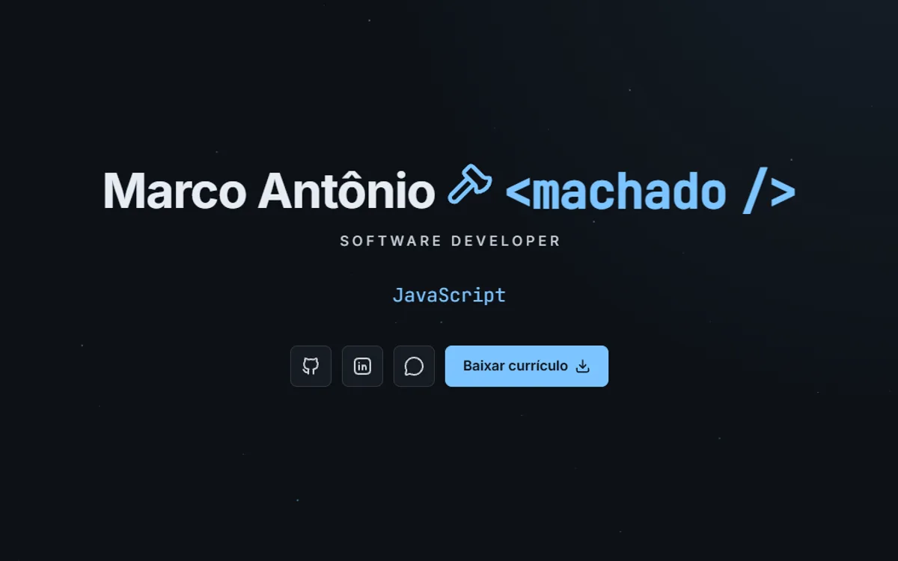

# Portfólio de Marco Antônio Machado

Meu site pessoal de desenvolvedor, feito em HTML, CSS e JavaScript.

Site: [marcomachado.dev.br](https://marcomachado.dev.br)

## Créditos

Os ícones e as fontes que uso no site são de outras pessoas, então deixo os créditos aqui:

* Ícones de interface: [Lucide](https://lucide.dev) (licença ISC) e [Tabler Icons](https://tabler.io/icons) (licença MIT).
* Ícones das tecnologias: [Devicon](https://devicon.dev) (licença MIT) e [Simple Icons](https://simpleicons.org) (licença CC0).
* Fontes: Inter e JetBrains Mono (licença SIL Open Font License).

## Contato

Fale comigo:

* E-mail: marcoamachado.dev@gmail.com
* LinkedIn: [linkedin.com/in/marcomachado-dev](https://www.linkedin.com/in/marcomachado-dev/)
